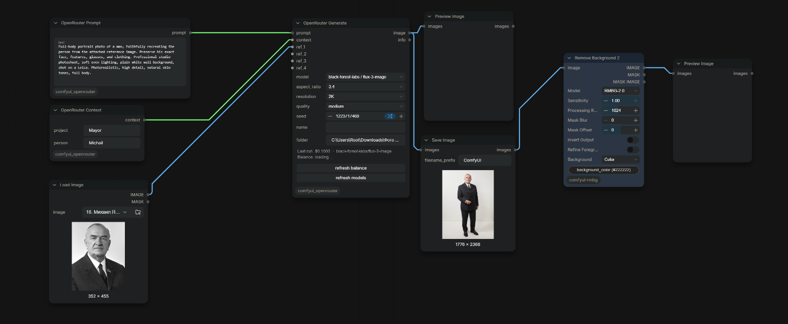

# comfyui-openrouter

ComfyUI nodes that generate images through [OpenRouter](https://openrouter.ai) with **your own API key**
(not Comfy credits). Every image is saved with a full recipe (prompt, model, seed, cost,
author, project, person, references, workflow) inside the PNG.

> **AI-generated code.** This project was written by an AI coding assistant
> (Claude, via Claude Code) under human direction. A human tested every feature in a
> real ComfyUI on Windows, and the code has automated tests, but please review it
> before relying on it.

Version 1.1.0 (beta: speech, video, JSON recipes). Design notes: `SPEC.md`. License: MIT.



*A reference photo and a prompt go into **OpenRouter Generate**; the result is saved
automatically with its recipe, the node shows the run's cost and your balance, and the
image can go on to any other node (here: background removal).*

## Nodes
| Node | What it does |
|---|---|
| OpenRouter Prompt | Multiline prompt text → STRING (any other STRING node works too) |
| OpenRouter Context | Project + person, typed once, wired to all Generate nodes of one person |
| OpenRouter Generate | Prompt + up to 4 reference images + model → IMAGE; saves the file; shows cost and balance |
| OpenRouter Speak | Text → speech (AUDIO); saves `.mp3` (or `.wav` for `pcm`) |
| OpenRouter Video | Prompt + optional first/last frame → video; saves `.mp4`, shows it on the node, outputs its path |
| OpenRouter Cost Report | Adds up the cost of all saved files in a folder, grouped by project, person, model, kind, date or author |

## Install (Windows, PowerShell)

**1. Put the node into ComfyUI** — either copy or link.

Copy: create `ComfyUI\custom_nodes\comfyui_openrouter\` and copy into it from this repo:
`__init__.py`, the `comfy_openrouter` folder and the `web` folder. Copy them again after
each update.

Or link (updates automatically):
```powershell
New-Item -ItemType Junction -Path "C:\path\to\ComfyUI\custom_nodes\comfyui-openrouter" -Target "C:\Github\comfyui-openrouter"
```

**2. Set your key (once)**
```powershell
[Environment]::SetEnvironmentVariable("OPENROUTER_API_KEY", "<your key>", "User")
[Environment]::SetEnvironmentVariable("OPENROUTER_USER", "yourname", "User")   # author name in metadata
```
Optional:
```powershell
# main folder for saved images (default: ComfyUI\output\openrouter)
[Environment]::SetEnvironmentVariable("OPENROUTER_OUTPUT_DIR", "D:\Shared\Generations", "User")
# management key: also show the whole account's remaining credit
[Environment]::SetEnvironmentVariable("OPENROUTER_MANAGEMENT_KEY", "<management key>", "User")
```

**3. Fully restart ComfyUI** (close the console window too) and reload the browser page.
Nodes appear under **OpenRouter** in the node menu.

The key is never stored in workflows or images, so workflows can be shared safely.

## Usage

### Basic run
**Prompt** → `prompt` of **Generate**; **Context** → `context`; a **Load Image** with the
person's photo → `ref_1`. Pick a model, press Run. One run = one image per Generate node.
Seed is set to *randomize*, so pressing Run again gives a new variant.

### Generate settings
| Setting | Meaning |
|---|---|
| model | Sorted by company, then your favorites (★), then newest |
| aspect_ratio, resolution, quality | `auto` = not sent. Settings the model does not support are skipped (warning in the console) |
| seed | With *control after generate* (randomize / fixed / increment) |
| name | Short label for the file name: `face`, `fullbody`, `fix-hands` |
| folder | Empty = main folder. `ProjectX\portraits` = subfolder of it. `D:\Images` = exactly that folder |
| ref_1 … ref_4 | Reference images. A batch counts as several. Extra ones above the model's limit are not sent |

At the bottom of the node: **Last run** (cost, model), **balance** (key limit left, and
account credit if a management key is set), and the buttons **refresh balance** and
**refresh models** (downloads the newest image, video and speech model lists and updates
the dropdowns).

### Saved files
Every Generate run saves its image itself (no Save Image node needed), e.g.
`2026-11-16_ProjectX_IvanPetrov_fullbody_gemini-3-pro-image_003.png`.
Empty parts are left out; existing files are never overwritten. The node's `info` output
shows the file name. Drag a saved PNG into ComfyUI to reopen its workflow.

Each PNG also carries `openrouter` metadata (schema `openrouter-meta/1`, see `SPEC.md`)
with a pixel hash of the image and of each reference, so a catalog tool can show which
image was made from which.

Every saved file (image, audio, video) also gets a **JSON recipe** with the same name,
e.g. `..._001.png` + `..._001.json` (schema `openrouter-meta/2`: the same fields plus
`kind`, `file` and `file_hash`). A video's recipe lists the pixel hash of its first/last
frame, so it links back to the portrait it was made from.

### Cost report
Add **OpenRouter Cost Report**, pick **group_by** and optionally **since**
(`2026-11-01`) and **folder** (same meaning as on Generate), press Run. The totals are
shown on the node and on its `report` output. It reads the `.json` recipes (and the
metadata inside older PNGs that have no `.json`); files without a known cost (e.g.
speech) are counted and marked "without cost".

### Speech and video
- **Speak**: pick a model from the dropdown. Leave **voice** empty for the model's
  default voice. Voice names differ per model (`alloy` works only for OpenAI); if a name
  is wrong, the error message lists the valid voices for that model.
  The **voice list** dropdown shows the voices OpenRouter lists for the selected model
  and fills in **voice** when you pick one. When OpenRouter lists none, it uses your
  `user\model_voices.json` (`{"model id": ["voice", …]}`, or a prefix like
  `"elevenlabs/"`), else a built-in list (ElevenLabs: george, sarah, … from its
  openrouter.ai page).
  ♂/♀ marks come from your own `user\voices.json` (e.g. `{"rex": "male"}`), a gender
  given by the provider, or a clear naming rule (Kokoro `af_…` = female, `am_…` = male).
  Voices without a mark are simply unknown, not guessed.
  **language** (the first setting) narrows the **model** dropdown to models for that
  language and is saved with the workflow. OpenRouter has no language field, so a model
  matches when its description names the language; models that only say "multilingual"
  or "48 languages" match every language and show `· multilingual` (unconfirmed).
  `user\languages.json` has the final say: a model listed there gets exactly the listed
  languages, e.g. `{"speechify/simba-3.5": ["ru", "en"], "assemblyai/assemblyai-tts-1":
  ["en"]}`. Add models there once you know which really speak your language.
  Some providers (e.g. ElevenLabs) need a voice name and OpenRouter lists none for them;
  take the voice name from the model's page on openrouter.ai.
  `format` `pcm` is saved as `.wav` (assumed 24 kHz mono); `mp3` needs
  torchaudio with mp3 support for the AUDIO output (the file is saved either way).
  OpenRouter does not report speech cost, so it shows as unknown.
- **Video**: when you pick a model, the node shows its allowed lengths and resolutions,
  its price per second and an estimate for the chosen **duration**, **resolution** and
  **generate_audio**. Seedance models are priced per video token
  (width × height × 24 fps × seconds / 1024), which matches OpenRouter's advertised
  price. Plain prices are shown "per s (assumed unit)"; token-priced models with an
  unknown rule show no estimate. The duration field is limited to the model's longest
  length. Check the real cost afterwards on the node or in the Cost Report.
  Connect a Generate image to `first_frame` (and optionally `last_frame`).
  `duration` 0 = model default; values the model does not support are not sent
  (console warning). A job takes from 30 s to several minutes; the node waits and stops
  waiting if you press Cancel (OpenRouter may still charge for the started job).
  Video costs much more than images.

### Files you can edit
Created next to the node in `user\` on first run:
- `favorites.json` — list of favorite model ids, e.g. `["google/gemini-3-pro-image"]`.
  Favorites get a ★ and come first within their company. Press **refresh models** after editing.
- `settings.json` — `filename_pattern`, default
  `{date}_{project}_{person}_{name}_{model}_{counter}`.
- `voices.json` — your ♂/♀ marks for voices, e.g. `{"rex": "male", "eve": "female"}`.
- `model_voices.json` — voice names for models OpenRouter lists none for, e.g.
  `{"some/tts-model": ["anna", "boris"]}` or a prefix `{"provider/": [...]}`.
- `languages.json` — languages of speech models for the filter, e.g.
  `{"speechify/simba-3.5": ["ru", "en"]}` (language codes: en, ru, uk, de, fr, es, it,
  pt, pl, tr, ar, hi, zh, ja, ko).
- `models_cache.json`, `video_models_cache.json`, `speech_models_cache.json` — the last
  model lists (let ComfyUI start offline).

## Example workflows
Drag a file from `examples\` into ComfyUI, load your photo in **Load Image**, and pick
models in the dropdowns (the examples use `google / gemini-3-pro-image`).

| File | Shows |
|---|---|
| `01_single_person.json` | Prompt + Context + reference photo → one image |
| `02_face_fullbody_tweak.json` | Chain: face → full body → fix, each step uses the previous image as `ref_1` |
| `03_four_variants.json` | 4 Generate nodes with one prompt = 4 variants per Run |
| `04_model_comparison.json` | One prompt → 3 Generate nodes, pick a different model in each |
| `05_speak.json` | Text → speech → Preview Audio |
| `06_portrait_to_video.json` | Generate a portrait, then use it as the first frame of a video |

For the next person: copy the nodes (Ctrl+C / Ctrl+V), change Context, prompt and photo.

## Troubleshooting
- **Model dropdown says "no models"**: the key was not set when ComfyUI started. Set it,
  restart ComfyUI fully, then press **refresh models**.
- **"no credits left or key limit reached"**: top up on OpenRouter or raise the key limit.
- **Node does not appear**: check the ComfyUI console for `comfyui_openrouter` and
  `IMPORT FAILED`.

## Sharing results with other people
Point `OPENROUTER_OUTPUT_DIR` on both PCs at a folder synced by Syncthing (free, works over
Tailscale) or Dropbox. Not Git — it is not made for large images. Use subfolder names
(not full paths) in the **folder** box of shared workflows.

## Development
```powershell
uv sync
uv run pytest
uv run python examples/make_examples.py   # rebuild the example workflows
```

## AI-generated
The code, tests, examples and docs were generated by an AI coding assistant (Claude, via
Claude Code), directed and tested by a human. Bug reports and pull requests are welcome.

## License
MIT — see `LICENSE`.
